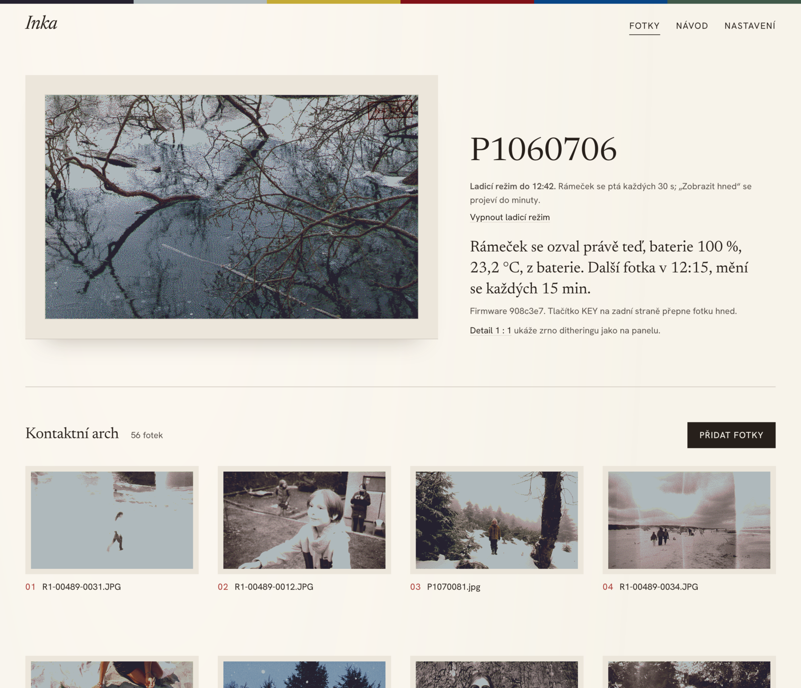
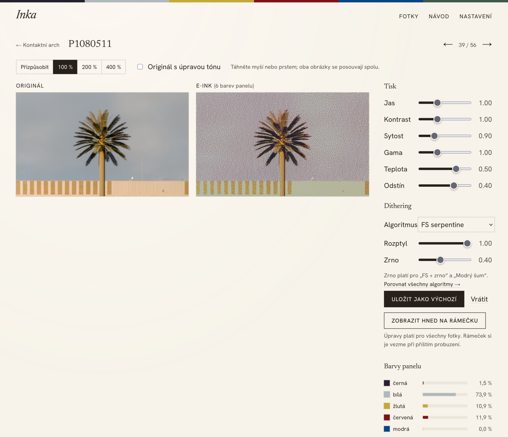
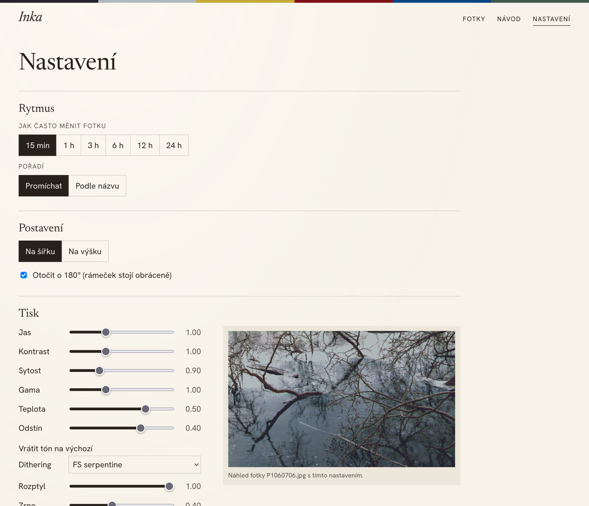

# Inka

A personal e-ink photo frame built on the Waveshare ESP32-S3-PhotoPainter with a 7.3" Spectra 6 colour panel. It runs custom ESP-IDF firmware. A small FastAPI server crops, tones and dithers the photos for the panel's six inks.

This is a single-user prototype, not a finished product. The web UI, tool messages and code comments are in Czech.



| Original vs. e-ink comparison | Settings |
|---|---|
|  |  |

The web UI also has a guide to the frame's buttons and LEDs ([screenshot](docs/img/navod.png)).

## How it works

```
photo folder ──► server (FastAPI) ──► GET /api/v1/frame ──► frame (ESP32-S3)
(Syncthing, web)  crop, rotate, tone,      ready 4-bit image       wakes up, downloads,
                  dither to 6 colours      800×480, ETag           redraws, sleeps
```

- **Firmware** (`firmware/`, ESP-IDF 5.5) only downloads and displays images.
  - Power: light sleep on USB power, deep sleep on battery. It wakes on a timer or a button press.
  - Reporting: sends battery level and temperature to the server.
  - Buttons: KEY shows the next photo. Holding PWR switches the frame off.
- **Server** (`server/`, Python 3.11+) does all the image work.
  - It crops and rotates each photo and adjusts tone: brightness, contrast, saturation, gamma, warmth and tint.
  - It dithers the result into the panel's measured palette. Six algorithms are available: Floyd–Steinberg, serpentine FS, FS with grain, blue noise, Atkinson and Jarvis–Judice–Ninke. All except plain FS run as numba kernels.
- **Web UI** has these pages:
  - an overview with frame status (last contact, battery, temperature, next photo) and a contact sheet of all photos,
  - an original vs. e-ink comparison at 100–400 % zoom with live tone and dithering controls,
  - a page comparing all dithering algorithms on one photo,
  - settings,
  - a guide to the buttons and LEDs.

## Layout

| Path | Contents |
|---|---|
| `firmware/` | ESP-IDF project: display, AXP2101 PMIC, Wi-Fi and download, sleep, stored frame |
| `server/` | FastAPI server, rendering and dithering, web UI, tests (`pytest`) |
| `tools/` | ESP-IDF setup, NVS provisioning, camera debug loop, panel measurement |
| `deploy/` | systemd unit and one-time server setup (Cloudflare tunnel, Tailscale) |
| `docs/` | hardware and colour calibration notes, deployment runbook, screenshots |

## Running it

Run the server locally:

```bash
cd server
PHOTOS_DIR=~/Pictures/inka DATA_DIR=/tmp/inka-data INKA_DEVICE_TOKEN=$(openssl rand -hex 16) \
  uv run inka-server --host 0.0.0.0
```

The web UI is then at `http://localhost:8100/`. `INKA_TZ` sets the time zone for times shown in the UI (default `Europe/Prague`).

Run the tests:

```bash
cd server && uv run pytest
uv run --with pytest --with pyserial pytest tools
```

Build, flash and provision the firmware:

```bash
tools/install_idf.sh                       # ESP-IDF version from firmware/.idf-version
cp firmware/provision.example.env firmware/provision.local.env   # fill in Wi-Fi, server URL, token
bash -c 'source tools/env.sh && cd firmware && idf.py build flash'
bash -c 'source tools/env.sh && python3 tools/provision.py'
```

`provision.py` stores the Wi-Fi credentials, server URL and token in the frame's NVS partition. None of them are in the repository.

## Documentation

- [Hardware notes](docs/hw-notes.md): measured timings, panel orientation, sleep and power, palette and dithering calibration.
- [Deployment](docs/deploy.md): running the server as a systemd user service behind a Cloudflare tunnel and Tailscale.

## License

MIT, see [LICENSE](LICENSE).

Third-party code:

- `firmware/components/board/xpowers/` is [XPowersLib](https://github.com/lewisxhe/XPowersLib) by Lewis He, MIT.
- The panel init sequence (`firmware/components/epd/`) and the board pins and PMIC setup (`firmware/components/board/board.cpp`) follow Waveshare's [ESP32-S3-PhotoPainter](https://github.com/waveshareteam/ESP32-S3-PhotoPainter) xiaozhi-esp32 example, MIT.
